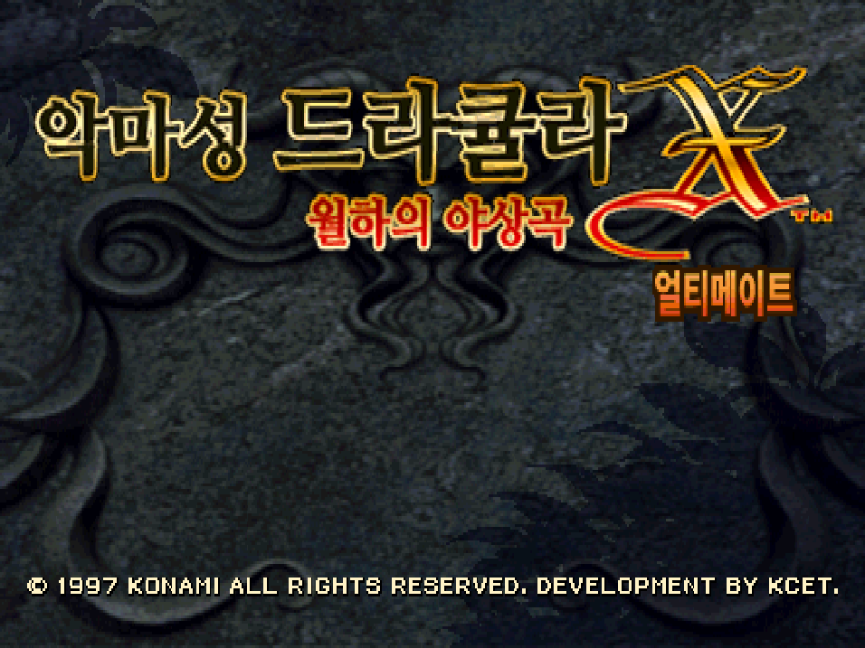
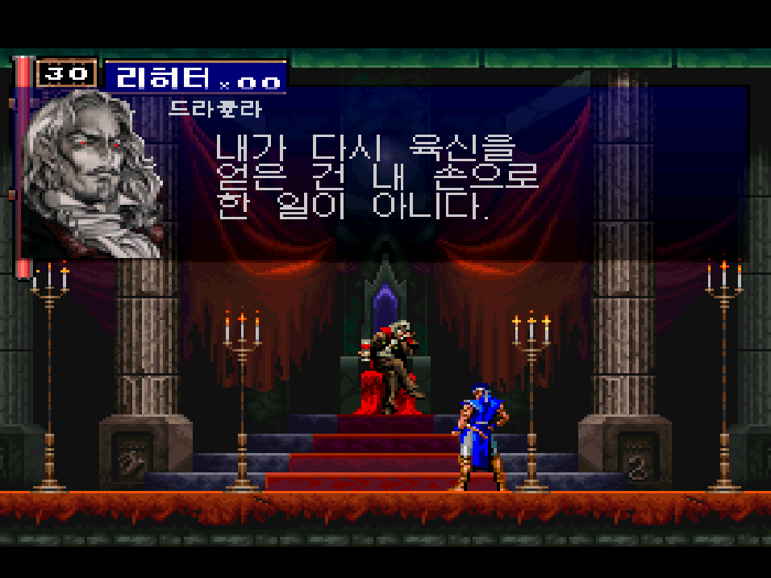
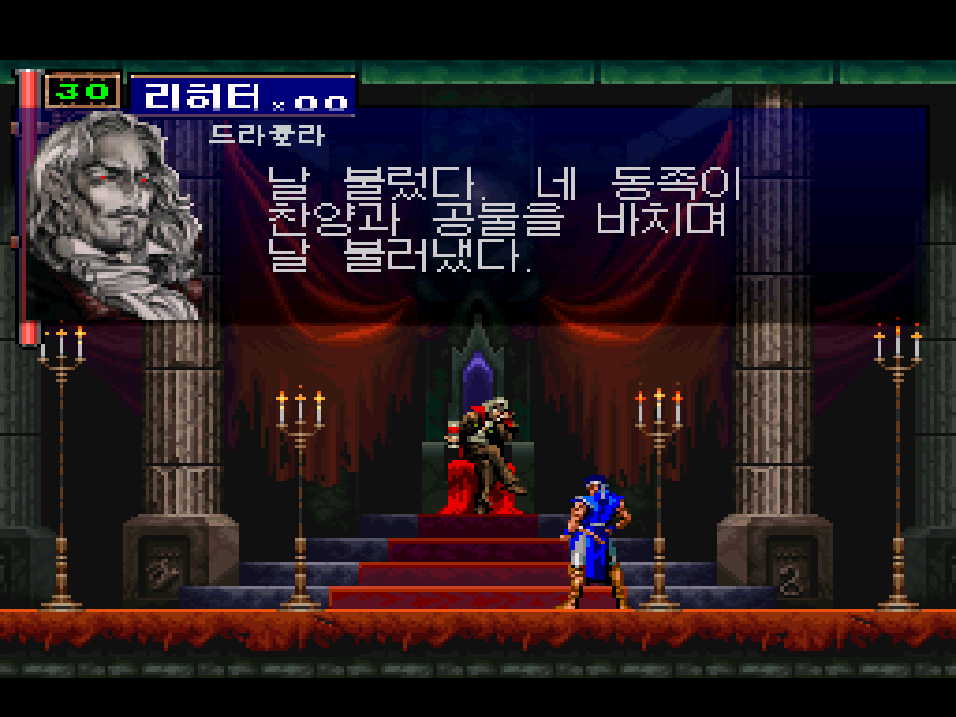
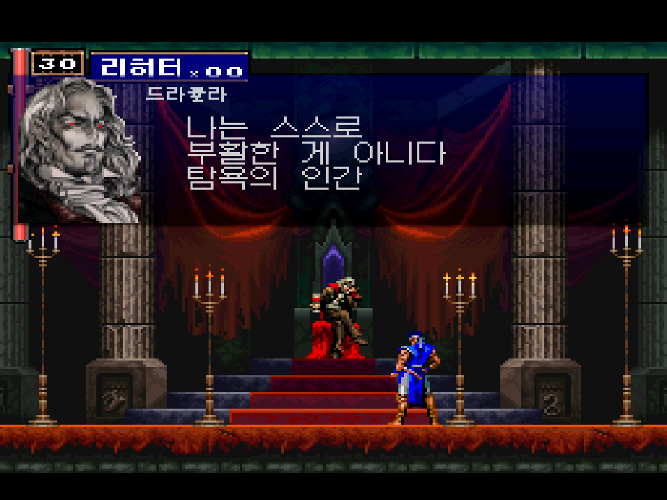
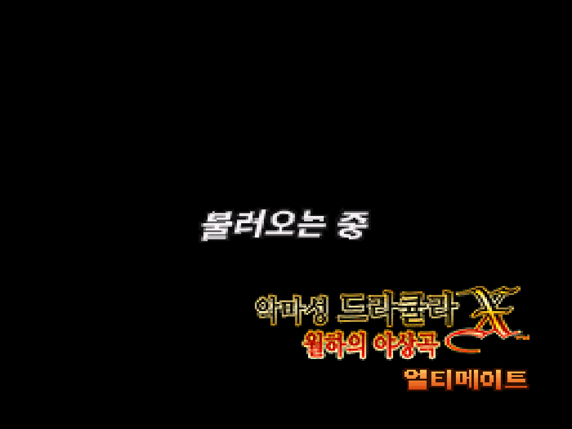
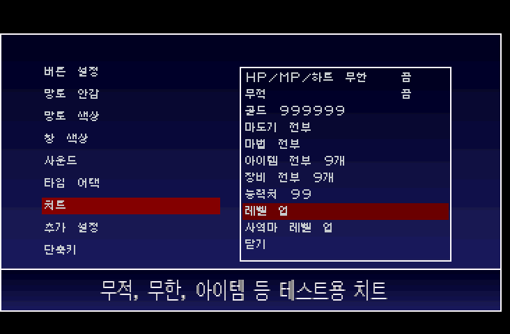
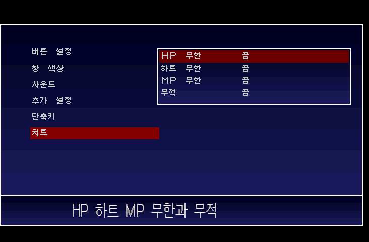
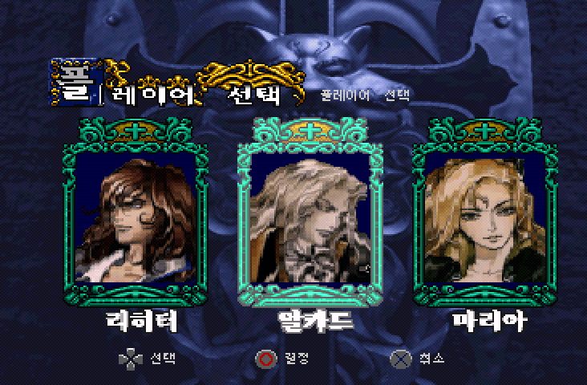

# 악마성 드라큘라 X 월하의 야상곡 얼티메이트 (PS1) — 한글 패치 v2.0 (원본 v1.4용)

<p align="center"></p>

팬 개조판 **SOTN Ultimate (PS1 Version) v1.4**(PS1판에 새턴판·PSP판의 요소를 합친 개조판)를 우리말로 옮긴 비공식 팬 패치입니다.

**목표는 '영어 0개'.** 대사, 메뉴, 아이템, 지역 이름, 제목·불러오는 중 화면 그림까지 한글로 바꿨습니다.

**[⬇ 패치 내려받기 (v2.0)](https://github.com/kanx030/sotn-ultimate-ps1-kr/releases/tag/ult-v1.4)** · 적용 방법은 [아래](#패치하는-법)를 보세요.

## 특징

### 🗣 음성 설정마다 따로 맞춘 대본
- **PS1 영어 음성, PSP 영어 음성, 일본어 음성** 각각의 대사에 맞춰 따로 번역했습니다.
- 일본어 음성은 실제 음성 길이에 맞춰 자막이 찍히도록 속도를 맞췄습니다.
- 일본어 음성일 때 오프닝 자막에 일본판 낭독이 함께 나옵니다.

| PS1 영어 음성 | PSP 영어 음성 |
|---|---|
|  |  |
| **일본어 음성** | **불러오는 중 화면** |
|  |  |

### 🎮 편의 기능
- **버튼 배치 선택**: 일시정지 → 설정 → 추가 설정 → "버튼"에서 ○ 결정 / × 결정을 고릅니다(세이브에 저장).
- 켤 때 코나미 영상을 건너뛰어 제목 화면이 빨리 뜹니다.
- 신속의 신발: 켜 두면 늘 달립니다(마도기 메뉴에서 끌 수 있음).
- 모든 한글은 도트 글꼴 **갈무리(Galmuri)**로 통일했습니다.

### 🛠 치트
- **알카드**: 일시정지 → 설정 → 치트 (HP/MP/하트 무한, 무적, 골드, 마도기·마법·아이템·장비 전부, 능력치 99, 레벨 업)
- **리히터·마리아**: 일시정지 화면에서 **L1+R1** HP 무한, **L2+R2** 하트 무한 켜기/끄기

| 알카드 치트 | 리히터·마리아 치트 |
|---|---|
|  |  |

<p align="center"></p>

## 표기 기준
- 음성마다 그 음성의 대사를 기준으로 번역했습니다. 일본어 음성은 일본어 대사 기준입니다.
- 이름은 한국에 알려진 표기를 따랐습니다(트레버·라네드 등, 일본어 음성의 선조 이름만 랄프). 데스는 하오체, 마리아는 존댓말.
- lv, $, GOLD 같은 숫자 옆 표시와 이름 입력 알파벳은 원작 그대로 두었습니다.

## 원본 롬 정보
- 패치 대상: 개조판 제작 페이지(`builder.html`, [SOTN Ultimate v1.4](https://github.com/renanbianchi/sotn-ultimate/releases/tag/v1.4))로 만든 `SOTN Ultimate (PS1 Version) v1.4.bin`
- 만들 때 필요한 디스크 (Redump):
  - `Castlevania - Symphony of the Night (USA)` (SLUS-00067)
  - `Akumajou Dracula X - Gekka no Yasoukyoku (Japan) (2M)` (T-9527G)
  - `Castlevania - The Dracula X Chronicles (USA)` (ULUS-10277)

| 항목 | 값 |
|---|---|
| CRC32 | `9B22D649` |
| SHA-256 | `C6EE705C8DC5F8BEEE0A11F7FC531EB671D7C02EEEF0F6F23527DC4F2A925B4C` |

## 패치하는 법
1. 원본 bin 의 CRC32·SHA-256 이 위 값과 같은지 확인합니다.
2. xdelta 로 패치를 적용합니다.
   - **받는 곳**
     - xdelta UI (윈도우, 창으로 쓰는 프로그램): https://www.romhacking.net/utilities/598/
     - xdelta3 (명령줄, 공식 배포): https://github.com/jmacd/xdelta/releases (윈도우는 `xdelta3-…-windows-x86_64.zip`)
   - **xdelta UI 로 적용**
     1. xdelta UI 를 실행하고 'Apply Patch' 탭을 엽니다.
     2. Patch 에 `sotn_ult_kr_v2.0_v1.4.xdelta`, Source File 에 원본 bin, Output File 에 `sotn_kr.bin` 을 지정합니다.
     3. 'Patch' 를 누르면 `sotn_kr.bin` 이 만들어집니다.
   - **xdelta3 로 적용**: `xdelta3 -d -s "SOTN Ultimate (PS1 Version) v1.4.bin" sotn_ult_kr_v2.0_v1.4.xdelta sotn_kr.bin`
3. 아래 내용을 메모장에 붙여 넣어 `sotn_kr.cue` 로 저장하고, `sotn_kr.bin` 과 같은 폴더에 둔 뒤 cue 파일로 실행합니다.

```
FILE "sotn_kr.bin" BINARY
  TRACK 01 MODE2/2352
    INDEX 01 00:00:00
```

## 확인 환경
- RetroArch + SwanStation, 덕스테이션(데스크톱·안드로이드)
- 바이오스: 북미판 PS1 바이오스(SCPH-1001 등). 일본 바이오스는 북미 디스크를 거부합니다(원본·정품도 같음).

## 알려진 점
- 덕스테이션에서 맞거나 변신할 때 알카드 그림이 가끔 깨지면 설정 → 영상(그래픽) → **텍스처 캐시 끄기**.
- 에뮬레이터 상태 저장(스테이트)은 판이 바뀌면 호환되지 않습니다. 메모리카드 세이브는 그대로 쓸 수 있습니다.
- 빠른 부팅·CD 읽기 가속·8MB 램은 끄는 것을 권합니다.

## 출처
- SOTN Ultimate (PS1 Version): renanbianchi — [romhacking.net](https://www.romhacking.net/hacks/10241/) · [GitHub](https://github.com/renanbianchi/sotn-ultimate)
- 글꼴: 갈무리(Galmuri) © Lee Minseo, Noto Sans KR / Noto Serif KR © Google, 함렛(Hahmlet) © The Hahmlet Project Authors — 모두 SIL OFL 1.1
- 버튼 배치(○ 결정)와 마리아 대화 건너뛰기 수정은 사용자분이 보내 주신 수정을 반영했습니다.

비영리 팬 작업입니다. 악마성 드라큘라 X 월하의 야상곡 © 1997 KONAMI
