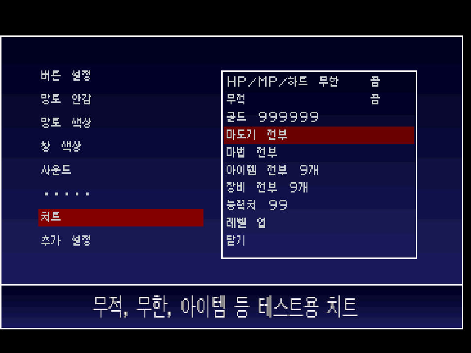
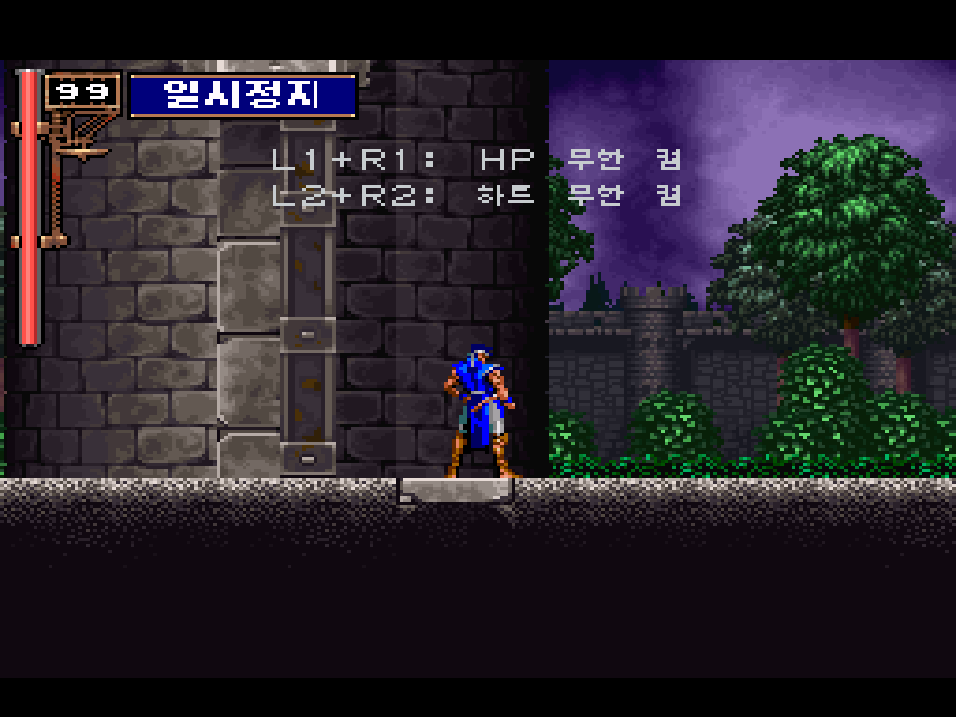

# 악마성 드라큘라 X 월하의 야상곡 얼티메이트 (PS1) 한글화

팬 개조판 **SOTN Ultimate (PS1 Version) v1.4** 를 한글로 옮기는 패치와 그 제작 도구입니다.
대사, 메뉴, 아이템, 지역 이름, 제목·불러오는 중 화면 그림까지 한글로 바꿨습니다.

## 받기
[배포 페이지](../../releases)에서 **원본 판에 맞는** xdelta 패치를 받아 원본 이미지에 적용하세요 (최신: `ult-v1.4`). 자세한 방법은 압축 파일 안 `읽어주세요.txt`에 있습니다.

- 원본: `SOTN Ultimate (PS1 Version) v1.4.bin` (704,762,688바이트)
  - CRC32 `9b22d649`
  - MD5 `901d74656aedbd8da3050d6a3716f32f`
  - SHA-1 `23bf226690c43663c93f75c4c82bb051d6eb15e1`
  - SHA-256 `c6ee705c8dc5f8beee0a11f7fc531eb671d7c02eeef0f6f23527dc4f2a925b4c`
- 패치 결과: `SOTN_Ultimate_KR.bin`
  - CRC32 `8d0c6dad`
  - MD5 `07c2f2090a9db3cf002dc0ec58c052e7`
  - SHA-1 `7240c481dcdb0670237bfbd6d4f8cb979ba49f18`
  - SHA-256 `6f543d6e3a0220b655a01eed1dcf2ad7bcc46ffb2b4fa4a35ce56c70915fab60`
- 게임 이미지는 제공하지 않습니다.

## 원본 이미지 만드는 법
원본 `SOTN Ultimate (PS1 Version) v1.4.bin`은 개조판 제작 페이지(`builder.html`)로 직접 만듭니다. 디스크 이미지 세 개가 필요합니다.

| 게임 | 파일 (Redump 등) | 크기 · CRC32 · MD5 |
|---|---|---|
| PS1 북미판 Castlevania: Symphony of the Night (SLUS-00067) | `Castlevania - Symphony of the Night (USA) (Track 1).bin` | 538,655,040 · `05be47b2` · `acbb3a2e4a8f865f363dc06df147afa2` |
| 새턴 일본판 악마성 드라큘라 X 월하의 야상곡 (T-9527G, 1.400판) | `Akumajou Dracula X - Gekka no Yasoukyoku (Japan) (2M) (Track 1).bin` | 481,720,176 · `f1b74601` · `32f037579707e192320db6e8f24ef571` |
| PSP 북미판 Castlevania: The Dracula X Chronicles (ULUS-10277) | `Castlevania - The Dracula X Chronicles (USA).iso` | 1,111,359,488 · `26316f37` · `9734bc89f4956324c28df897e25f1a71` |

1. **v1.4판** 제작 페이지를 받습니다: [GitHub - SOTN Ultimate v1.4](https://github.com/renanbianchi/sotn-ultimate/releases/tag/v1.4) (`builder.html`). 패치는 원본 판마다 따로 배포합니다 (v1.4용 `ult-v1.4`, v1.2용 `v1.0`).
2. `builder.html`을 PC 브라우저로 열고 세 이미지를 끌어다 놓은 뒤 "Build the disc"를 누릅니다.
3. 저장한 .bin의 MD5가 `901d74656aedbd8da3050d6a3716f32f`이면 됩니다.

개조판 정보: [romhacking.net](https://www.romhacking.net/hacks/10241/) · [제작 소스(GitHub)](https://github.com/renanbianchi/sotn-ultimate)

## 화면
| | |
|---|---|
|  |  |
|  |  |
|  |  |
|  |  |

## 특징
- 음성 설정마다 따로 맞춘 대본: PS1 영어 음성, PSP 영어 음성, 일본어 음성
- 일본어 음성일 때 오프닝 자막에 일본판 낭독
- 켤 때 코나미 영상을 건너뛰어 제목 화면이 빨리 뜸
- 모든 한글은 갈무리 글꼴(OFL)로 통일

## 치트
- **알카드:** 일시정지 → 설정 → **치트**
  - HP/MP/하트 무한, 무적, 골드 999999, 마도기 전부(신속의 신발 포함), 마법 전부, 아이템 전부 9개, 장비 전부 9개, 능력치 99, 레벨 업
- **리히터·마리아:** 일시정지 화면에서
  - **L1+R1**: HP 무한 켜기/끄기
  - **L2+R2**: 하트 무한 켜기/끄기
  - 화면에 지금 켜졌는지(켬/끔) 표시됩니다. 일시정지 중에만 바꿀 수 있습니다.

## 저장소 구성
- `tools/` 빌드 도구 (Python). 진입점 `tools/build.py <out.bin>` (`--test`는 시험용 입력 훅 포함)
- `work/trans/` 번역 시트 (PS1 영어 음성 `*.json`, PSP 음성 `*.psp.json`, 메뉴·설명 `DRA_*.json` 등)
- `오프닝자막.txt` 오프닝 자막 편집용 텍스트
- `진행상황.md` 작업 기록

## 저장소에 넣지 않은 것
- 게임 이미지와 추출 파일 (`원본롬/`, `work/U/` 등)
- 일본판 디스크 (오프닝 낭독을 가져옴, 배포 빌드에 필요)
- 일본어 음성 대본 번역: PSP 한글판 V1.3 번역을 참조해 일부를 고쳐 쓴 것이라 저장소에는 넣지 않았습니다 (`work/trans/*.jp.json`, `대사집.txt`).

## 글꼴
- 갈무리(Galmuri) © Lee Minseo, SIL OFL 1.1
- Noto Sans KR / Noto Serif KR © Google, SIL OFL 1.1
- 함렛(Hahmlet) © The Hahmlet Project Authors, SIL OFL 1.1 (게임오버 문구)

## 고마운 분들
SOTN Ultimate 제작자, 플스1·새턴·PSP 한글판 제작자분들께 감사드립니다.

비영리 팬 작업입니다. 악마성 드라큘라 X 월하의 야상곡 © 1997 KONAMI
