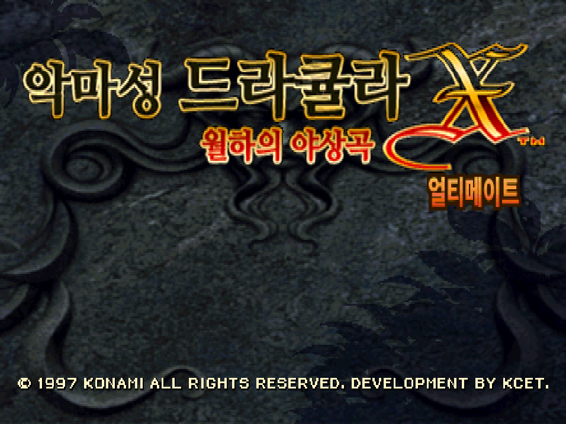
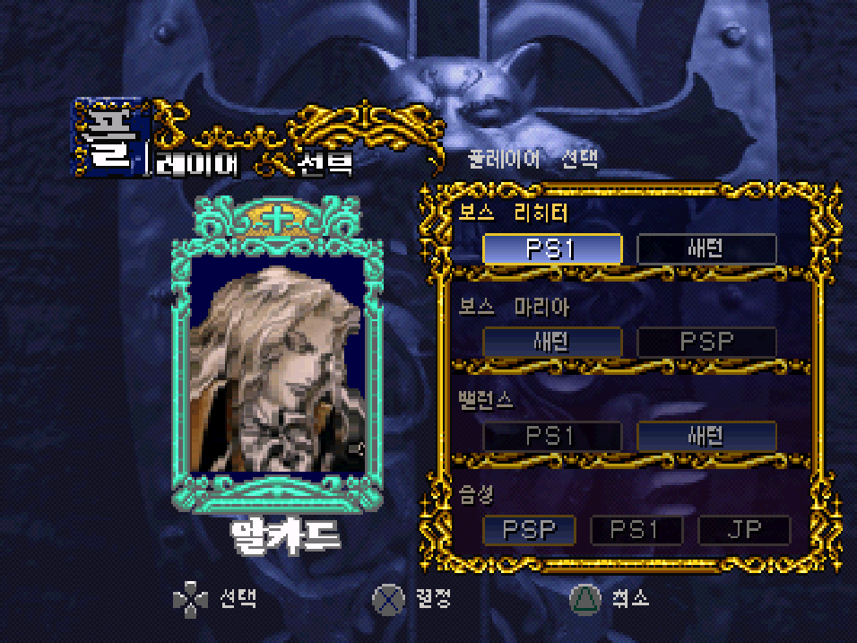
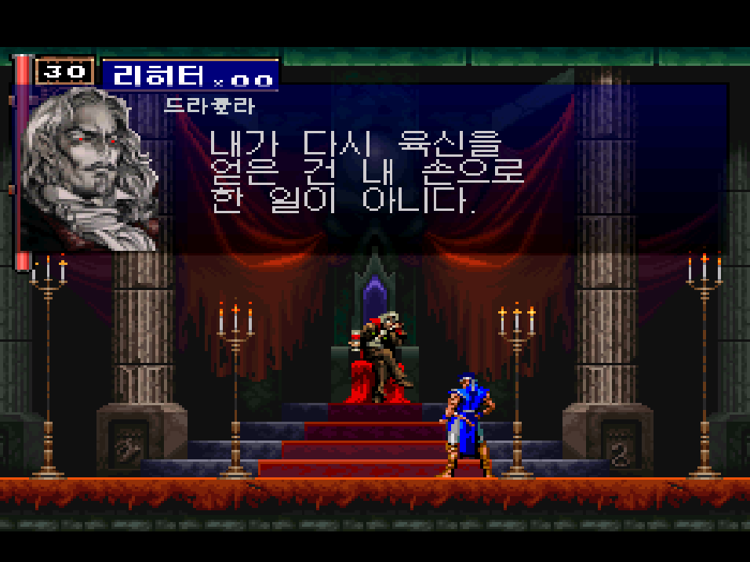
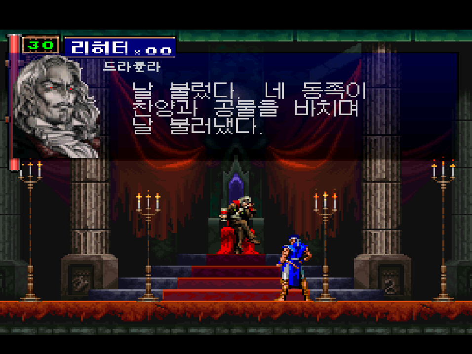
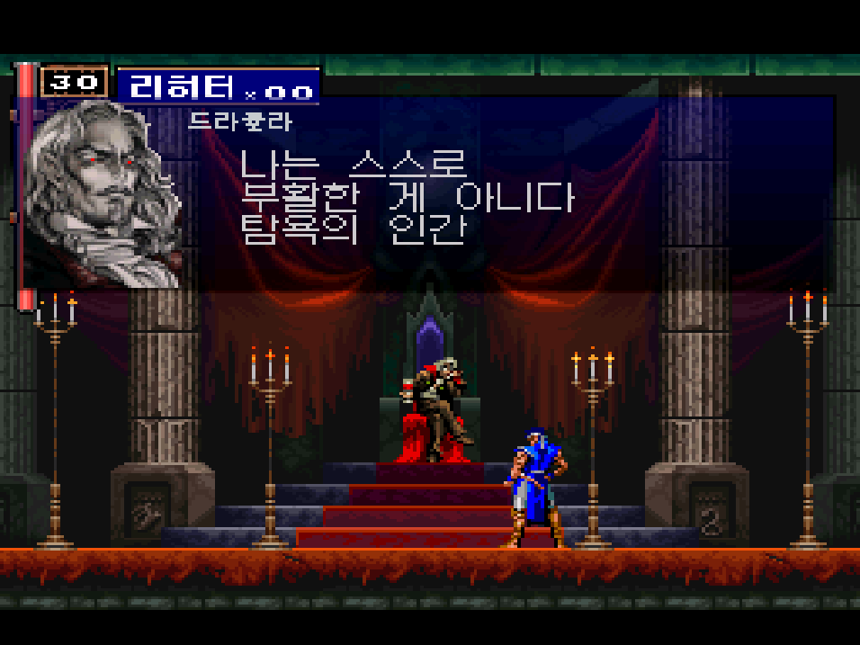
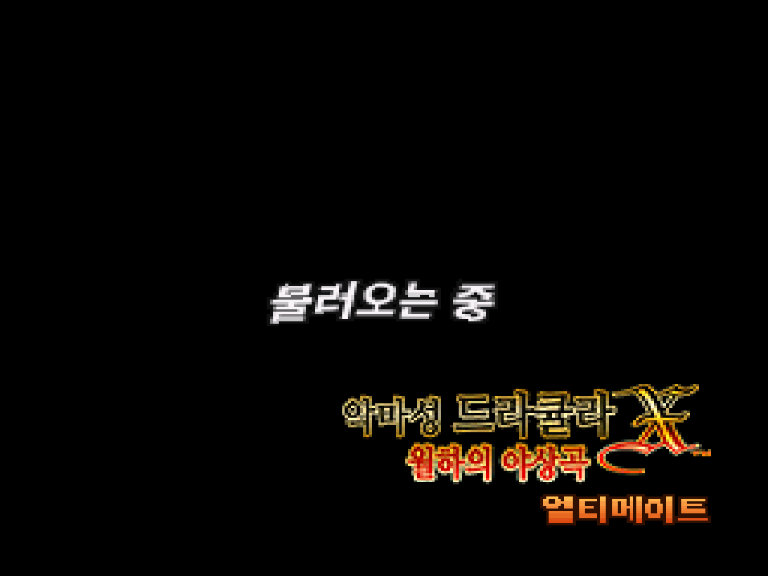

# 악마성 드라큘라 X 월하의 야상곡 얼티메이트 (PS1) 한글화

팬 개조판 **SOTN Ultimate (PS1 Version) v1.2** 를 한글로 옮기는 패치와 그 제작 도구입니다.
대사, 메뉴, 아이템, 지역 이름, 제목·불러오는 중 화면 그림까지 한글로 바꿨습니다.

## 받기
[배포 페이지](../../releases)에서 xdelta 패치를 받아 원본 이미지에 적용하세요. 자세한 방법은 압축 파일 안 `읽어주세요.txt`에 있습니다.

- 원본: `SOTN Ultimate (PS1 Version) v1.2.bin` (MD5 `b8b9cd07c9251919bcf02c8ebbb4602b`)
- 게임 이미지는 제공하지 않습니다.

## 화면
| | |
|---|---|
|  |  |
|  |  |
|  |  |

## 특징
- 음성 설정마다 따로 맞춘 대본: PS1 영어 음성, PSP 영어 음성, 일본어 음성
- 일본어 음성일 때 오프닝 자막에 일본판 낭독
- 켤 때 코나미 영상을 건너뛰어 제목 화면이 빨리 뜸
- 모든 한글은 갈무리 글꼴(OFL)로 통일

## 저장소 구성
- `tools/` 빌드 도구 (Python). 진입점 `tools/build.py <out.bin>` (`--test`는 시험용 치트 메뉴와 입력 훅 포함)
- `work/trans/` 번역 시트 (PS1 영어 음성 `*.json`, PSP 음성 `*.psp.json`, 메뉴·설명 `DRA_*.json` 등)
- `오프닝자막.txt` 오프닝 자막 편집용 텍스트
- `진행상황.md` 작업 기록

## 저장소에 넣지 않은 것
- 게임 이미지와 추출 파일 (`원본롬/`, `work/U/` 등)
- 일본판 디스크 (오프닝 낭독을 가져옴, 배포 빌드에 필요)
- 일본어 음성 대본 번역: PSP 한글판 V1.3 번역을 참조해 일부를 고쳐 쓴 것이라 저장소에는 넣지 않았습니다 (`work/trans/*.jp.json`, `대사집.txt`).

## 글꼴
- 갈무리(Galmuri) © Lee Minseo, SIL OFL 1.1
- Noto Sans KR / Noto Serif KR © Google, SIL OFL 1.1
- 함렛(Hahmlet) © The Hahmlet Project Authors, SIL OFL 1.1 (게임오버 문구)

## 고마운 분들
SOTN Ultimate 제작자, 플스1·새턴·PSP 한글판 제작자분들께 감사드립니다.

비영리 팬 작업입니다. 악마성 드라큘라 X 월하의 야상곡 © 1997 KONAMI
